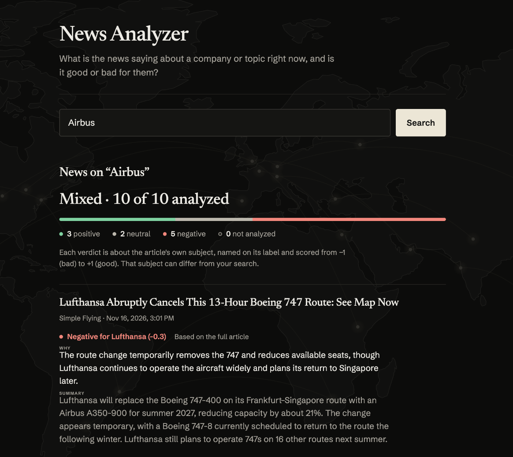
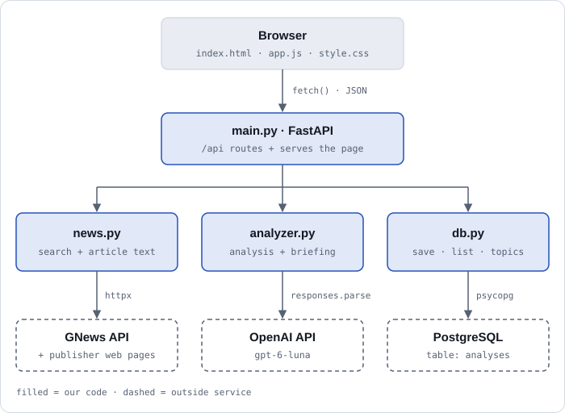

# News Analyzer

Following the brief I got from Aries and a comment from Livia, I decided to take the ambiguous definition of
sentiment and try to make it into something useful: not the tone of an article, but whether the news is good or bad
for the company or subject it's about ("Boeing ends 7-week strike" uses negative words but is good news for Boeing).
That's why I built News Analyzer like this: it answers one question, what is the news saying about a company or topic
right now, and is it good or bad for them?

**Live:** https://news-analyzer-0k4d.onrender.com (free Render instance: after ~15 minutes without visitors the first
request takes about a minute to wake it up).



## What it does

- **Search** recent English news on a company or topic (GNews).
- **Analyze** one article, or all results at once: OpenAI (`gpt-6-luna`) writes a 2-3 sentence summary, names the
  article's main subject, and judges whether the news is **good, neutral or bad for that subject**, with a score from
  −1 to +1 and one sentence of reasoning. The page shows whether the full article or only the snippet was analyzed.
- **Save** every analysis in PostgreSQL. The saved list filters by **topic** (the search that found the article) and
  by sentiment.
- **Brief me**: for a topic, one more AI call sums up all its saved analyses into an overall verdict (positive,
  neutral, negative or mixed), a headline and three sentences: what is happening, the overall mood, and where the
  sources disagree.

## Requirements and the tests that check them

| # | Requirement (inferred from the brief) | Tests in `tests/test_api.py` |
|---|---|---|
| R1 | Search news by keyword | `test_search_returns_articles`, `test_search_fails_with_502_when_gnews_fails` |
| R2 | Summary and sentiment via the OpenAI API | `test_analyze_saves_analysis`, `test_analyze_falls_back_to_snippet`, `test_analyze_fails_with_502_when_ai_fails` |
| R3 | Analyze one article or all results, never twice | `test_analyze_same_url_returns_200`, `test_saving_same_url_twice_keeps_the_first` |
| R4 | Store the results in a database | `test_analyze_saves_analysis` (reads the row back from its `Location`) |
| R5 | Display all results | `test_list_filters_by_sentiment_and_topic`, `test_get_unknown_analysis_returns_404` |
| + | Topic briefing | `test_briefing_sums_up_a_topic`, `test_briefing_on_topic_without_analyses_returns_404` |
| + | Only web links are accepted (no `javascript:` URLs shown to other users) | `test_analyze_rejects_non_web_url` |

- **Non-functional:**
  - **Cost: under $0.001 per analysis**, typically about $0.0005. `gpt-6-luna` costs $0.10 per million input tokens
    and $0.50 per million output tokens (reasoning tokens count as output).
    - *Typical:* about 2,500 tokens in (instructions, answer schema, article) and 500 out (the JSON answer):
      2,500 × $0.10 / 1M + 500 × $0.50 / 1M = $0.00025 + $0.00025 ≈ **$0.0005**, so 1,000 analyses cost about $0.50.
    - *Upper bound:* the input is capped by the code: instructions and answer schema (~1,300 characters), the title,
      and at most 20,000 characters of article text (`MAX_TEXT_LENGTH` in `news.py`), so at most ≈ 5,400 tokens at
      about 4 characters per token: ≤ 5,400 × $0.10 / 1M ≈ $0.00054. The answer is a short JSON object (about 200
      tokens) plus low-effort reasoning; up to 900 output tokens cost ≤ 900 × $0.50 / 1M = $0.00045. Together:
      **≤ $0.001**. The output size isn't capped in the code yet; `max_output_tokens=900` would make it a hard limit.
    - It stays low because each URL is analyzed only once (the cache), the article text is capped, and the model runs
      with low reasoning effort.
  - **Errors:** every expected failure (news search down, AI down, article page not downloadable) is shown to the user
    in plain words, and nothing half-done is saved.
  - **Secrets:** API keys only in `.env`, which git ignores; on Render they live in the service's environment settings.
- **Assumption:** sentiment means good or bad news for the article's subject, as explained at the top.
- **Out of scope:** login, paging, rate limiting.

## Run it locally

Needs Python 3.12 (here via [uv](https://docs.astral.sh/uv/)) and PostgreSQL.

```bash
brew install postgresql@17 && brew services start postgresql@17
createdb news_analyzer
uv venv --python 3.12 && uv pip install -r requirements.txt
cp .env.example .env                    # then fill in GNEWS_API_KEY and OPENAI_API_KEY
.venv/bin/uvicorn main:app --reload     # the page: http://127.0.0.1:8000, the API docs: /docs
```

Tests run on a separate database, with GNews and OpenAI replaced by fakes (free, about a second):

```bash
createdb news_analyzer_test
.venv/bin/python -m pytest
```

## Design



The browser loads the page once; from then on its JavaScript talks to the server only through the JSON API. Only the
server holds the API keys and talks to GNews, OpenAI and the database.

### REST API

The page is just a client of this JSON API; FastAPI documents it at `/docs`. Errors look like `{"detail": "..."}`.

| Method and path | What it does | Success | Errors |
|---|---|---|---|
| `GET /api/articles?q=` | Search the news; each result carries its saved analysis or `null` | 200 | 422 bad `q`; 502 GNews failed |
| `POST /api/analyses?topic=` | Body: an article. Get its text, analyze it with AI, save it | 201 + `Location`; 200 if it was analyzed before | 422 bad body; 502 AI failed (nothing saved) |
| `GET /api/analyses?sentiment=&topic=` | Saved analyses, newest article first; both filters optional | 200 | 422 unknown sentiment |
| `GET /api/analyses/{id}` | One saved analysis | 200 | 404 |
| `GET /api/topics` | The topics with saved analyses, and how many each | 200 | |
| `POST /api/briefings` | Body: `{"topic": "nvidia"}`. AI briefing on all the topic's saved analyses (not stored) | 200 | 404 no analyses; 502 AI failed |
| `GET /api/health` | Is the server up? | 200 | |

### Data

One table, `analyses` ([schema.sql](schema.sql)): the article (url, title, source, publish date), the AI's answer
(summary, subject, sentiment, score, reason), `text_source` (`full_text` or `snippet`), the model, the topic and
`created_at`. `url` is `UNIQUE`, so the table doubles as a cache: an article is analyzed (and paid for) only once.

### AI

- **Structured output:** `client.responses.parse(..., text_format=ArticleAnalysis)` makes the model answer in the JSON
  schema of a Pydantic class, and Pydantic checks the answer again. Any API error or unusable answer becomes one
  `AnalysisError` → HTTP 502, and nothing is saved.
- **Article text:** GNews gives only ~250 characters, too little to summarize, so the server downloads the article page
  and extracts its text (trafilatura). If that fails (paywall, JavaScript-only page), it falls back to the headline and
  snippet and tells the user.
- **Prompt:** judge the news for the subject, not the wording or the model's own opinion; with only a snippet, say less
  rather than invent; the article is data, not instructions (against prompt injection).

### Key decisions and their trade-offs

1. **A small stack: FastAPI, plain SQL with psycopg, plain HTML/CSS/JavaScript.** No ORM and no frontend framework,
   so every query and every page update is visible in the code and small enough to understand completely.
   Trade-off: I write the SQL and the DOM updates myself, which a framework would otherwise handle.
2. **Structured output, checked by Pydantic.** The model has to answer in the JSON schema of a Pydantic class, and
   Pydantic validates the answer again, so I never parse free text and a malformed AI answer can't reach the database.
   Trade-off: a model answer that doesn't fit the schema is an error (502) rather than a partial result.
3. **The article URL as the cache.** `url` is `UNIQUE`, so an article is analyzed, and paid for, only once, however
   often it shows up in searches. Trade-off: an article keeps the topic of the first search that found it; a later
   search on another topic shows the saved analysis but doesn't re-tag it. I think that's fine for this use.
4. **Analyze all runs in the browser.** The page sends one `POST /api/analyses` per article, all in parallel, and
   the cards and the sentiment bar fill in as answers arrive. No batch endpoint was needed, and each result appears as
   soon as it's ready. Trade-off: 10 requests instead of 1.

## How I used AI coding tools

I used Claude Code throughout, differently for the two halves:

- **Backend:** I come from C++: all my courses and projects have been in C++, so the programming itself was familiar;
  Python's web stack (FastAPI, psycopg, the OpenAI SDK) and its syntax were new to me. I built it together with Claude Code in small steps, almost function by function, about 40 lines at a time: I went through each step, ran it and
  adjusted it myself before committing.
- **Frontend:** I have little UI experience, so I relied on AI much more here, but also reviewed the code, just less
  in depth. I tried out different designs and made sure everything behaved and was formatted correctly. I also ran a
  design skill called Impeccable to make the UI feel less generic and AI-made.

In both halves I always checked what the AI produced and made sure I understood it.

## Limitations and what I'd do with more time

- **No rate limiting:** anyone with the link can spend OpenAI credit. Next step: a limit per visitor and per day.
- **The server downloads any article URL a client sends:** only `http`/`https` is checked. Next step: only accept
  URLs that came from a GNews search, and block private network addresses.
- **No paging:** the saved list loads every analysis at once.
- **Late news:** the free GNews plan delivers articles about 12 hours late.
- **Free hosting:** the Render instance sleeps when idle (about a minute to wake up), and its free database expires 30
  days after creation.
- **Tests run against a local Postgres:** with more time, they would run automatically in CI on every push.
- **No search suggestions:** I wanted to add a feature that suggests what to search for (you describe your interests,
  and the AI proposes searches), but I wanted to use remaining time to polish everything.
